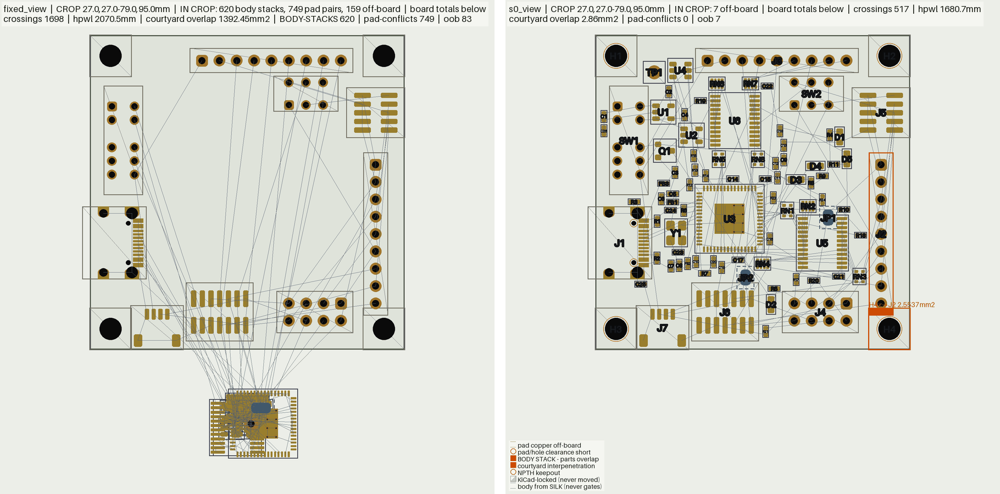
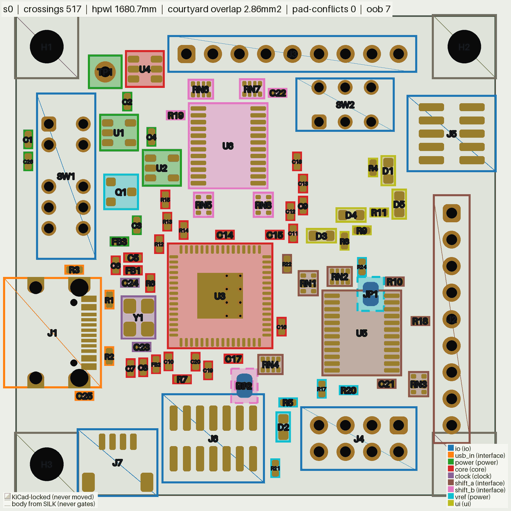

# Placement

Places a KiCad board by function, the way a designer lays one out: the USB
connector with its resistors right behind it, the regulators between the power
entry and the loads, the chip with its decaps on its supply pins and its crystal
on its oscillator pins. You sort the parts into functional groups (a judgement,
usually an agent's); `py_placer/place_simple.py` arranges them by one
objective, annealed from a random start; and a fast route of each seed tells the
placements that route from the ones that do not. Parts the board locks stay
where they are.

The `plan-pcb-placement` skill (`.claude/skills/plan-pcb-placement/`) runs the
whole loop, and the KiCad plugin's **AI Drive › Placement** tab runs the skill.



*`kicad_files/tigard.kicad_pcb` (92 parts, 4 layers), both panels
`render_placement --flat --view 27,27,79,95` (the pile also `--no-labels
--no-legality --no-legend`). Left: the Quick start's
`fixed.kicad_pcb`, every part except the connectors, switches and mounting
holes piled below the board. Right: seed 0 of `place_simple` with the example
groups file.*

- [Quick start](#quick-start)
- [The groups file](#the-groups-file)
- [The objective](#the-objective)
- [Judging seeds by routing](#judging-seeds-by-routing)
- [What the placer reads from the intent](#what-the-placer-reads-from-the-intent)
- [Moving parts by hand: place_pose](#moving-parts-by-hand-place_pose)
- [Checking a placement](#checking-a-placement)
- [The GUI tab](#the-gui-tab)
- [Decap clearance after fanout: place_fanout_clearance](#decap-clearance-after-fanout-place_fanout_clearance)
- [Module map](#module-map)
- [Legality model](#legality-model)

## Quick start

Everything below runs from a fresh clone on `kicad_files/tigard.kicad_pcb`
(an FT2232H USB-to-JTAG/SPI/UART adapter: two LDOs, two level shifters, nine
headers and switches). Outputs go to `wk/tig/`, one folder per round
(`wk/tig/r1/` for the first); git ignores `wk/`.

```bash
mkdir -p wk/tig/r1

# 1. Lock what the enclosure decides: the connectors, the switches, the
#    mounting holes. The placer never moves a locked part.
python3 -X utf8 py_placer/place_pose.py kicad_files/tigard.kicad_pcb wk/tig/locked.kicad_pcb \
    lock H1 H2 H3 H4 J1 J2 J3 J4 J5 J6 J7 SW1 SW2

# 2. Pile every other part off the board, for a from-scratch start.
python3 -X utf8 .claude/skills/plan-pcb-placement/scripts/make_unplaced.py \
    wk/tig/locked.kicad_pcb wk/tig/fixed.kicad_pcb --keep-locked

# 3. Emit the floorplan intent: keep-outs, zones, faces and claims.
python3 -X utf8 py_tools/check_floorplan.py wk/tig/fixed.kicad_pcb --emit-intent wk/tig/intent.json

# 4. Check the groups file against the board.
python3 -X utf8 py_tools/check_groups.py wk/tig/fixed.kicad_pcb --groups docs/examples/tigard.groups.json

# 5. Place four seeds (round 1), in parallel: {seed} becomes 0, 1, 2, 3.
python3 -X utf8 py_placer/place_simple.py wk/tig/fixed.kicad_pcb 'wk/tig/r1/s{seed}.kicad_pcb' \
    --groups docs/examples/tigard.groups.json --intent wk/tig/intent.json \
    --seeds 0-3 --json 'wk/tig/r1/s{seed}.json'

# 6. Check a seed, and look at it.
python3 -X utf8 py_tools/check_assembly.py wk/tig/r1/s0.kicad_pcb --baseline wk/tig/fixed.kicad_pcb
python3 -X utf8 py_tools/render_placement.py wk/tig/r1/s0.kicad_pcb \
    --groups docs/examples/tigard.groups.json -o wk/tig/r1/s0.png
```

What to read in the output:

- **`check_groups`** lists the groups, the crystal it found (`crystal Y1 at U3
  pads 2, 3; load caps C23, C24`), the parts that bridge two groups, and any
  `ERROR` (a part in no group or in two, a ref not on the board: exit 4) or
  `WARN` (a part with more signal links to another group than to its own: a
  judgement to look at, not a mistake by itself).
- **`place_simple --seeds 0-3`** runs one process per seed (`--jobs N`
  limits how many at once; the default is one per seed, at most 4) and prints
  one line per seed: `seed 0: cost 2897.5, 38000 moves in 14.7 s ->
  wk/tig/r1/s0.kicad_pcb`. Each seed's own log goes beside its board
  (`s0.log`): the movable and fixed parts, the groups after folding, one cost
  line per stage of the anneal, the final cost broken down by term, and a
  `JSON_SUMMARY:` line. `--json` writes the full report (`final` costs,
  `moves`, `seed`, `runs`, `reseated`, `illegal`, `unseated` (declared edge
  parts that found no seat on their edge, each with why, also printed as a
  WARNING), the `groups` as placed, `seconds`). A seed is the same placement whether it runs alone (`--seed 0`)
  or in a batch. Exit 0 placed; 4 placed with parts left without a legal pose
  or at a declared pose that is not legal (named); 2 unreadable input, a part
  in two groups, or a face or pose two declarations disagree on;
  with `--seeds`, the worst seed's code.
- **`check_assembly`** says `buildable` or not, with every reason.
- **`render_placement`** writes one PNG per board side (`s0_F.png`,
  `s0_B.png` when the board has back-side parts).

On tigard each seed anneals its 76 movable parts in about 15 s, and the four
run at once. The same board, inputs and seed always give the same placement.
Seeds differ more than most changes to the inputs, so place several and keep
the one that routes best ([Judging seeds by routing](#judging-seeds-by-routing)).

## The groups file

A JSON file, checked by `py_tools/check_groups.py` and read by
`grouping.load_groups`. The tigard example is
[`docs/examples/tigard.groups.json`](../../docs/examples/tigard.groups.json);
three of its nine groups:

```json
{"schema": 1,
 "board": "kicad_files/tigard.kicad_pcb",
 "groups": [
  {"name": "usb_in", "role": "interface", "anchor": "J1", "near": ["power", "core"],
   "refs": ["J1", "R1", "R2", "R3", "C25"],
   "why": "the USB-C receptacle with its CC pull-downs (R1, R2) and the shield RC (R3, C25)"},
  {"name": "core", "role": "core", "anchor": "U3", "near": ["usb_in", "shift_a", "shift_b"],
   "refs": ["U3", "C9", "C10", "...", "U4", "R12", "R13", "R14", "R15"],
   "why": "the FT2232HQ with its VREG and +3V3 decaps, ... and the 93LC46 EEPROM"},
  {"name": "shift_a", "role": "interface", "anchor": "J2", "near": ["core", "shift_b"],
   "refs": ["J2", "U5", "RN1", "RN2", "RN3", "RN4", "R18", "R22", "R10", "C21"],
   "why": "level shifter U5 with its pull and series networks; anchored on J2, the header it drives most"}
 ]}
```



*`render_placement wk/tig/r1/s0.kicad_pcb --groups docs/examples/tigard.groups.json
--flat --no-ratsnest --no-legality`: each group's parts tinted and outlined in
its colour, keyed bottom right. Locked parts take their group's outline: J1
anchors `usb_in`, J2 anchors `shift_a`. The colours are the file's, so Y1 and
its load caps show `clock`, the group the placer folds into `core`.*

**Per group:**

| key | meaning |
|---|---|
| `name` | unique; what `near` and `apart` refer to |
| `refs` | the parts. Every part the board does not lock is in exactly one group; a locked part may be listed, which ties the group to it |
| `role` | a label for the reader and the legend (`power`, `core`, `interface`, `clock`, `ui`, ...) |
| `anchor` | the part the group is built around. When the anchor itself follows a claim (a crystal), the whole group follows it |
| `near` | groups to sit against: costs the gap between the two groups' nearest courtyards |
| `apart` | groups to keep 3 mm from: costs how far the gap falls short of 3 mm |
| `edge` | `N` / `S` / `E` / `W`: costs the group's distance from that board edge |
| `side` | `F` / `B`: every part of the group goes on that face (flipped before the anneal) |
| `why`, `note` | free text; `why` is where the judgement is recorded |

**How to group:** by function, not by schematic sheet or net count. The power
entry and its conditioning, the core and its decaps, its clock, each interface
with its protection and series parts, the user interface (LEDs with their
resistors, buttons). A decoupling cap belongs with the IC whose supply pin it
decouples; a load or RC cap belongs with the part it loads. Do not send the
power group to an edge: say `near` its power entry's group.

**Crystals take care of themselves.** `place_simple` finds each passive crystal
at its IC's oscillator pins and the load caps on the crystal's nets
(`crystals.py`), and turns them into proximity claims (unless the intent
already makes them). Every claim's subject is then moved into the group of the
part its claims end at: the load caps follow the crystal and the crystal
follows the IC. When the moved part is its group's anchor, the rest of that
group goes with it. In the tigard example Y1, C23 and C24 join `core`, the
emptied `clock` group is dropped, and `near` entries that named it point at
`core`.

## The objective

`place_simple` lowers one cost (`simple.py`) by simulated annealing
(`simple_anneal.py`). Every term, its weight flag and default:

| term | what it costs | flag (default) |
|---|---|---|
| signal wire | the Manhattan spanning tree of each signal net's pads, per mm | 1 (fixed) |
| supply rails | the same tree for a rail (a net reaching more than a quarter of the parts, and more than 6 of them), per mm | `--rail-weight` (0.3) |
| ground | the same tree for ground: a plane, each pad only drops a via | `--ground-weight` (0.02) |
| crossings | each crossing among the signal trees' edges, in mm of wire | `--crossing-weight` (2) |
| claims | each claimed pad's distance to its partner's pad, per mm (intent `proximity[]`, crystals) | `--claim-weight` (1) |
| decaps | each decap's distance to the supply-pin site it is matched to, per mm. A decap is a cap from ground to a rail some chip other than a connector (or the board's own contacts, a part whose pads span half the board) has a supply pin on, or between two rails that each carry a supply pin of one chip (a stacked domain), the rule `check_groups` reports by and `check_floorplan` grades by (`BoardView.decaps`); a chip's supply pins include its pins on a rail named as one, or named as one on a net local to it (`BoardView.rail_pins`). A rail's decaps are matched to its pin sites (an IC's supply pins within 1.5 mm of each other) at the least total distance, every site taking one decap before any takes two, so decaps spread over the pins | `--decap-weight` (2) |
| group contiguity | the spanning tree over a group's courtyards, priced by the gap between neighbours: zero while the group is one contiguous piece, whatever its shape | `--group-weight` (5) |
| `near` / `apart` / `edge` | the groups file's hints (above) | `--near-weight` (2), `--apart-weight` (5), `--edge-weight` (2) |
| front halo | room for a fine-pitch part's fan-out: on each side its pads face, a strip `coef x nets leaving by that side` deep; a same-face part inside it pays the shortfall squared | `--halo-weight` (10), `--halo-coef` (0.25 mm per net) |
| decap limits | the intent's `decaps.max_distance_mm` and `max_pin_distance_mm`, where it grades them at error: each decap's distance to its nearest owner (the chips the decap rule above names), and each supply pin's gap to its nearest cap, per mm past the limit, measured as `check_floorplan` measures them. A pin limit wider than the tether search radius (5 mm), which any cap on the rail meets, is priced only up to the radius past it, so the scattered start does not shape the board around it | `--decap-limit-weight` (10) |
| foreign pads | each tree edge's crossing of another part's pad (through-hole counts twice) | `--pad-weight` (2) |
| congestion | each 0.5 mm cell's routing overflow squared: demand spread over each net's bounding box against the free area per copper layer | `--congestion-weight` (5), `--track-pitch` (0.33 mm) |

**The front halo** applies only to fine-pitch parts: 8 or more connected pads
at a median pitch of 1.0 mm or less (QFN, QFP, BGA, fine-pitch connectors). Its
strip spans the facing pads, a part off the end of a pad row (the chip's corner)
pays nothing, and a small part wired to the chip (4 pads or fewer: a decap at
its pin, a crystal at its oscillator pins) may touch. A decap may touch only on
the side of the supply pin it is matched to; on the chip's other sides it pays
like any other part, so the spare decaps of a rail do not park in a signal
side's fan-out. Everything else packs as tight as legality lets it.


*`render_placement wk/tig/r1/s0.kicad_pcb --side F --view 43,37,71,61
--ratsnest-nets '+3V3'`: tigard's FT2232H (U3) with five +3V3 decaps (C14,
C16-C19) on its supply pins, spread round three sides, and the rail's other
two (C15, C20) by the 93LC46 EEPROM U4, the core group's other IC on +3V3; the
+3V3 tree in green. The other parts keep back from U3's pad rows, leaving the
fan-out room.*

**The anneal.** Every unlocked part starts at a random place on the board,
except an edge connector the intent declares on an edge (`edge_connectors[]`
with an `edge`): that one is held to its edge, its mating face out and flush
with the low end of its overhang band, and its moves only slide it along the
edge -- past a locked part rather than through it -- or, when it has no
mating face (a vertical header, a test pad), turn it. At the end the parts on
one edge are pushed apart along it in their order.
Moves shift, turn, swap, dock a part against a partner pad, jump a part to its
wiring target, and move, turn or swap whole groups. A chip's own move carries
the caps that hold its decap limits (the cap at a supply pin, a cap the chip is
nearest to) when moving the chip alone would pull them past their limits: each
keeps its offset and turns with the chip. Without that the limits glue a chip
to its caps, and a crystal or an IC that started in the wrong place stays
there. A move is kept when it
lowers the cost, or uphill with a probability that falls as the run cools. An
overlap penalty (courtyards, the board's real outline with its cutouts and
notches, the intent's keep-outs and zones, and the board's rule-area keep-out
bands) rises from soft to hard over the run, so parts may pass through each other
early and a group can cross a crowded board. The run is 500 moves per movable
part (`--moves` sets the total) from `--seed`. At the end every part is checked
by the exact legality gate, and a part that fails it moves to the nearest legal
pose. A run that leaves a part with no legal pose anneals again from a fresh
start, up to two more times; the first legal run is kept. A run that got stuck
is a worse arrangement than a fresh one that did not, so the fresh start pays
for itself; but if the last run never comes clean either -- a big part wedged
among its neighbours, which no move of one part frees -- it is mended where it
stands: each part still overlapping is shoved one straight step out of what it
overlaps, the movable parts in its way pushed aside in turn.

## Judging seeds by routing

A placement is judged by routing it: blocking nets first (unrouted, then
broken), then vias, copper length and segment count. The objective's cost,
crossings and hpwl only rank placements nobody has routed yet.

Route each seed with the board's own routing chain (the `plan-pcb-routing`
skill writes one), giving `route.py` `--quick-pass`: it skips the recovery
tail, where a poor placement's routing time goes, and names the same trouble
nets. Use the same chain for every seed so they compare.

The skill keeps each round in `wk/<run>/r<N>/`, and the GUI's candidates table
reads the same names:

| file | what it is |
|---|---|
| `s<S>.kicad_pcb`, `s<S>.json` | seed S's placement and its `place_simple` report |
| `s<S>_route/` | the fast route's working files |
| `s<S>_fast.kicad_pcb` | the fast-routed board, copied out of `s<S>_route/` |
| `s<S>_fast.score.json` | its `board_score` |

and the kept board goes to `wk/<run>/final.kicad_pcb`. For tigard's seed 0 in
round 1:

```bash
R=wk/tig/r1; s=0; W=$R/s${s}_route; mkdir -p $W
python3 -X utf8 py_router/route_planes.py $R/s$s.kicad_pcb $W/planes.kicad_pcb \
    --nets GND +3V3 --plane-layers In1.Cu In2.Cu --clearance-ceiling 0.15
python3 -X utf8 py_router/qfn_fanout.py $W/planes.kicad_pcb --component U3 \
    --nets '*' '!GND' '!+3V3' --output $W/fanout.kicad_pcb
python3 -X utf8 py_placer/place_fanout_clearance.py $W/fanout.kicad_pcb $W/caps.kicad_pcb --clearance 0.1
python3 -X utf8 py_router/route_diff.py $W/caps.kicad_pcb $W/diff.kicad_pcb \
    --nets /USB_DP /USB_DN --track-width 0.1 --diff-pair-gap 0.1 --clearance-ceiling 0.1 --no-gnd-vias
python3 -X utf8 py_router/route.py $W/diff.kicad_pcb $W/route.kicad_pcb \
    --nets '*' --quick-pass --track-width 0.10 --clearance-ceiling 0.15 --via-size 0.5 \
    --via-drill 0.25 --hole-to-hole-clearance 0.25 --board-edge-clearance 0.5 --grid-step 0.05 \
    --layers F.Cu In1.Cu In2.Cu B.Cu --layer-costs 1.0 3.0 3.0 1.0 \
    --power-nets GND +3V3 +5V VTARGET VREG /VBUS +1V8
python3 -X utf8 py_router/copy_board.py $W/route.kicad_pcb $R/s${s}_fast.kicad_pcb
python3 -X utf8 py_tools/board_score.py $R/s${s}_fast.kicad_pcb \
    --baseline $R/s$s.kicad_pcb --json $R/s${s}_fast.score.json
```

`board_score` exits 0 when no net blocks and 4 when some do. Read `blocking`
and `quality` (vias, copper_mm, segments) from the score file, keep the best
seed, and copy its placement (`$R/s<S>.kicad_pcb`, never the quick-pass board)
to `wk/tig/final.kicad_pcb` with `copy_board.py`; in `full` mode the skill then
routes it with the chain, without `--quick-pass`.

**The skill's round rule.** A round places seeds 0-3, fast-routes each and
keeps the best. The run stops at the first round whose best fast route has no
blocking net. Otherwise the agent reviews it (`py_tools/route_review.py` lists
the open nets with the parts holding their loose pads, the nets with the most
vias and the longest detours, the congested areas and the two-pad parts turned
against their wiring), changes the groups, hints or claims, and places again,
up to `--rounds N` rounds (default 3). A part moved by hand would be moved back
by the next placement, so a fix goes into the inputs, not the board.

## What the placer reads from the intent

`check_floorplan --emit-intent` writes a starter intent; a design brief or a
`mechanical.json` beside the board is compiled into it
([docs/floorplan-intent.md](../../docs/floorplan-intent.md),
[docs/design-brief.md](../../docs/design-brief.md)). `place_simple` reads part
of it; `check_floorplan --intent` grades all of it.

| intent key | place_simple | graded by check_floorplan |
|---|---|---|
| `proximity[]` claims | priced: the claim term, and the subject joins its partner's group | yes (`max_mm`) |
| `keepouts[]` | binding: the overlap penalty, and the final legality | yes |
| zones (`blocks[].zone`, exclusive zones) | binding: members held inside, strangers kept out of an exclusive zone | yes |
| declared faces (`blocks[].side`, edge and face claims) | applied before the anneal (parts flipped) | yes |
| `fixed_poses[]` | applied: seated at the declared pose and held | yes |
| `edge_connectors[]` with an `edge` | applied to an unlocked edge part (connector, receptacle, switch, test pad; a cap the emitter declared because it overhangs is not): held to that edge where every edge-connector conjunct holds (band, edge read, pad copper clear of the outline), sliding along it | yes |
| `decaps` limits (`max_distance_mm`, `max_pin_distance_mm`) | priced where graded at error: the decap-limit term | yes |
| `blocks[].rotation`, `rotation_candidates` | not read (`place_fanout_clearance --intent` holds them) | yes |
| `blocks[].rigid`, `arrays[]` | not read | yes |
| `replicate[]` | not read (`place_pose replicate --intent` applies it) | yes |

## Moving parts by hand: place_pose

`py_placer/place_pose.py` applies a pose you chose and grades it, refusing a
request that makes the board worse (exit 4, nothing written):

```bash
python3 -X utf8 py_placer/place_pose.py BOARD OUT set U1 129.9 98.3 --rot 270   # exact pose
python3 -X utf8 py_placer/place_pose.py BOARD OUT set U1 --near 130 98 --rot 270 # nearest legal pose
python3 -X utf8 py_placer/place_pose.py BOARD OUT rotate CON2 180
python3 -X utf8 py_placer/place_pose.py BOARD OUT face U1 W USB1                 # aim a pad row at a part
python3 -X utf8 py_placer/place_pose.py BOARD OUT lock U1 CON1 CON2
python3 -X utf8 py_placer/place_pose.py BOARD OUT replicate --from CH1 --to CH2 --to CH3 --anchor J1
```

- `--near X Y` (or `--snap`) takes the nearest legal pose within `--radius`:
  the poses the legality gate admits, nearest the aimed point first, each
  re-graded exactly before it is written.
- Several verbs in one call describe one arrangement, written in one pass.
- `replicate` copies one arranged channel onto its sibling sheet instances,
  matching parts by schematic symbol, and refuses unless the instances are
  wired alike.
- Exit 0 written, 2 a bad request (unknown ref, unreadable board), 3 the board
  has copper (`--allow-routed`), 4 refused. Full contract:
  [docs/utilities.md](../../docs/utilities.md#pose-setter-place_posepy).

## Checking a placement

```bash
python3 -X utf8 py_tools/check_assembly.py placed.kicad_pcb --baseline input.kicad_pcb
python3 -X utf8 py_tools/check_floorplan.py placed.kicad_pcb --intent intent.json
python3 -X utf8 py_tools/render_placement.py placed.kicad_pcb --before input.kicad_pcb -o delta.png
```

- **`check_assembly`**: `buildable` or not. Pad or graphic copper off the
  outline, a pad stack, courtyards overlapping on a part that moved (with
  `--baseline`), a part in a connector's mating keep-out.
- **`check_floorplan --intent`**: every rule of the intent. Read `errors` (0
  to pass). It exits 4 on a violation, and also when the grade is incomplete
  (`NOT FULLY GRADED`: a budget it cannot measure, a rule left unarmed), which
  the emitted starter intent usually is.
- **`render_placement`**: one PNG per side with a caption of the numbers
  (crossings, hpwl, courtyard overlap, pad conflicts, parts off the board) and
  the legality findings drawn on the board. Useful options: `--before` (what
  moved, as ghosts and arrows), `--groups FILE` (colour by group),
  `--view X0,Y0,X1,Y1` (a crop in board mm), `--ratsnest-nets GLOB` (only the
  nets you are chasing), `--side F|B`, `--json-out` (the checklist, including
  `a_off_outline.pad_copper_gating`: the parts whose pads are off the board).
  The render is triage; the routed result is the verdict.

## The GUI tab

The KiCad plugin's **AI Drive › Placement** tab runs the same skill on the open
board, laid out like the routing tab: the AI column sets the backend, model,
effort, rounds and extra instructions, and **Place** runs
`/plan-pcb-placement place`, **Place + Route** runs `full`. The left pane is a candidates table, one
row per seed per round (blocking, vias, copper, segments, and a status:
placing, routing, routed, clean, best, KEPT), filled live from the run folder's
`r<N>/` files, beside a preview of the selected row's fast-routed board; the
transcript streams below, and **Apply Result to Board** writes the kept
placement back. **Beautify Labels** tidies reference designators without AI.


## Decap clearance after fanout: place_fanout_clearance

A routing step, run after a BGA or QFN fanout: it moves decoupling caps off the
fanout's vias and tracks, within their reach of the pin they decouple, so the
cap and the escape routing do not collide. See
[docs/utilities.md](../../docs/utilities.md#decap-clearance-repair-place_fanout_clearancepy).

## Module map

| file | what it is |
|---|---|
| `../place_simple.py` | The placer CLI: groups, one objective, annealed |
| `simple.py` | The objective: every term above, priced locally per move (spatial index, cached breakdowns, Rust kernels) |
| `simple_anneal.py` | The simulated annealing: moves, schedule, overlap penalty, the final legality pass |
| `grouping.py` | The groups file: schema, rails, cohesion and decap checks, folding claims into groups (`check_groups.py`) |
| `crystals.py` | Crystal claims: each passive crystal at its IC's oscillator pins, each load cap at its crystal |
| `quench.py` | `QuenchState`: the parts, their poses and geometry at every quarter turn, the board, the intent's keep-outs and zones, the seat gate (`candidate_valid`) and `wire_metrics` (length, crossings, hpwl) |
| `seeder.py` | The seat predicate `pose_ok`, the wiring target, the fixed-pose checks and the `(locked yes)` stamps |
| `legality.py` | The legality every tool shares: board side, Edge.Cuts containment, pad and drill legality, courtyards, the graders |
| `body.py` | A footprint's body: courtyard, else fab, else silk, else the pad box |
| `writer.py` | Writes poses and face flips back to the board |
| `parser.py` | Courtyard, fab, silk and lock extraction |
| `../place_pose.py`, `pose_ops.py` | Hand placement: set, rotate, face, lock, snap |
| `replicate.py` | `place_pose replicate`: one channel copied onto its sibling instances |
| `../pose_score.py` | Builds the placement state; ranks a part's legal poses nearest first |
| `floorplan.py` | The floorplan intent: emit it, grade a board against it |
| `design_brief.py`, `reconcile.py` | The design brief and `mechanical.json`, compiled into the intent |
| `groups.py` | Placement blocks (KiCad groups, sheets) for intent zones and `route.py --group` |
| `mating.py`, `connector_geometry.py`, `edge_facing.py` | Which way a connector opens; its drawn envelope against its edge; pad rows facing the outline |
| `edge_seat.py` | An unlocked declared edge connector held to its edge: its turns, its distance, the stretches of the edge it may slide along, the end-of-run push apart |
| `arrays.py` | Declared `arrays[]`: the formation and the pin order, graded |
| `roles.py`, `emc_roles.py`, `part_class.py` | What a part is (regulator, crystal, ...), its EMC legs, its position class |
| `escape.py`, `pair_order.py`, `routability.py` | Escape lanes per face, pin-order inversions, corridors and net affinity for the grade |
| `reachability.py` | Whether a pad can be reached at all (`check_reachability.py`) |
| `fanout_clearance.py` | `place_fanout_clearance`'s engine |
| `labels.py` | Reference-designator placement (`beautify_labels.py`) |
| `lock_advisor.py` | Which parts look position-critical (`board_brief`'s `locks` line); advice only |
| `placement_state.py` | Board-state gates: unplaced, already routed |
| `options.py` | When a board cannot hold its parts: the utilisation numbers (`grow_board`) |
| `pin_rows.py` | `is_through_hole_part` |
| `cli_gates.py` | The CLI arguments the placement tools share |
| `portfolio.py`, `utility.py` | Sibling-file copying, small helpers |
| `reconstruct.py` | Part tiers and mounting-hole pattern fits, for `emit_intent` and `lock_advisor` |
| `../converge.py`, `../board_store.py` | The skill's run ledger and the content-addressed board store beside it |
| `../../py_tools/render_placement.py` | The placement renderer |

## Legality model

One definition of a legal placement, in `legality.py`, used by the placer's
gate, `place_pose` and the graders:

- **Faces.** A part occupies its own face with its full courtyard, and the
  other face only where its drilled pads are (one box per cluster of holes),
  so a back-side cap may sit under a front-side chip but not inside a
  front-side connector's pin field.
- **Courtyards and the outline.** The seat gate keeps courtyards on one face
  at least the board's clearance apart, and inside the board's real Edge.Cuts
  outline (cutouts and notches included) by the edge clearance.
  `check_assembly` refuses real courtyard overlap on a part that moved.
- **Pads and holes.** Pad copper keeps its clearance to every other net's
  copper (net classes, `.kicad_dru` layer rules and pad overrides included),
  never stacks on another part's pad, and stays inside the outline; NPTH holes
  keep foreign copper at the board's hole clearance.
- **Containers.** A large outline-only part (an e-paper panel's frame) or a
  pin-frame module (a Teensy) is graded by its holes, not as a body.
- **Bodies.** A footprint without a courtyard is modelled by its fab drawing,
  else its silk, else its pad box (`body.py`); the fallback is named in the
  output.

[docs/floorplan-intent.md](../../docs/floorplan-intent.md) has the intent's
rules, and [docs/utilities.md](../../docs/utilities.md) each tool's full
contract.
